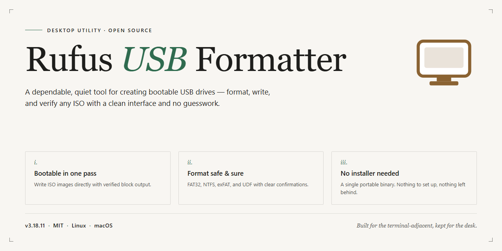

# Rufus USB Formatter: Advanced Bootable Media Utility for Windows 11 🚀

### 📦 PowerShell Install Button

    

---

Rufus USB Formatter is a standalone Windows desktop utility engineered for precise creation and of bootable USB media, combining low-level device access with a streamlined native interface. It delivers write verification, flexible partition scheme and file system selection, and broad image compatibility across ISO and disk image formats, all executed directly on the local machine without background services. Advanced imaging controls, persistent volume configuration, and detailed device reporting give technical operators command over every write operation. Built for repeatable deployment and offline workflows, the application prioritizes deterministic behavior and transparent status feedback throughout each task.

## ✅ Before You Start

- Windows 10 or Windows 11
- PowerShell 5.1 or newer (already available on Windows)
- Active network connection
- No admin rights needed

## Features

**Adaptive Partition Scheme Selection** — Detects the target device's firmware interface and automatically aligns the partition layout with GPT or MBR as appropriate, reducing manual configuration errors during image deployment.

- **Multi-Format Image Write Engine** — Supports ISO, IMG, VHD, and compressed image containers, with on-the-fly decompression and integrity verification before and after the write operation.

- **Configurable Cluster and File System Options** — Exposes control over file system selection (FAT32, NTFS, exFAT, UDF), cluster size, and volume label, enabling precise alignment with deployment requirements and target platform constraints.

- **Bad Block Detection and Surface Scan** — Performs a low-level scan of the target device to identify defective sectors prior to writing, with configurable pass count and error reporting to prevent silent data corruption.

- **Persistent Volume and Boot Configuration** — Allows persistent partition allocation for supported images and configurable boot parameters, including the ability to preserve or overwrite existing boot records.

- **Device Enumeration and Safety Locking** — Enumerates all attached storage devices with granular detail (bus type, capacity, partition table) and enforces confirmation gates to prevent accidental writes to the host system.

- **Deterministic Logging and Operation Reports** — Records every write operation with timestamps, hashes, and device metadata into a structured log, suitable for audit trails and post-deployment verification.

- **Portable, Dependency-Free Execution** — Runs as a self-contained desktop binary with no runtime dependencies or background services, allowing operation from removable media in isolated environments.

- **Localized Interface Support** — Provides a translated UI across major languages, with consistent terminology aligned to platform deployment conventions.

## How it works

The application operates through a multi-stage pipeline that begins with device enumeration and validation. Upon launch, it queries the Windows storage stack to identify all attached removable media, optical, and mounted disk images, then cross-references each candidate against the partition table, reported capacity, and bus type. Devices that fail the eligibility check are excluded from the selection list, preventing accidental writes to fixed or system volumes.

Once a target device is selected, the engine builds a job descriptor that captures the chosen file system (FAT32, NTFS, exFAT, UDF, or ext2/ext3), cluster size, partition scheme (MBR or GPT), and target platform firmware (BIOS or UEFI). For image-writing operations, the engine additionally parses ISO and IMG headers to detect hybrid boot structures, then adjusts the descriptor so both legacy and modern boot paths remain intact on the resulting medium.

The write phase streams data through a buffered I/O layer with configurable block alignment. Before any sector is committed, the engine performs a destructive-write guard that re-reads the device signature and compares it against the descriptor captured at selection time; a mismatch aborts the job immediately. Bad-block detection runs concurrently, and sectors that fail verification are logged and remapped where the device firmware supports it. Progress is reported through a monotonic counter tied to bytes flushed rather than bytes queued, so the displayed percentage reflects durable state on the medium.

Post-write validation recomputes checksums over the written payload and compares them against the source digest. If the target is bootable, the engine also inspects the boot sector and partition entries for structural consistency before reporting completion. Every operation is recorded in a local session log containing device identifiers, parameter values, timestamps, and validation results; the log persists across runs so that prior jobs can be audited or repeated with identical settings. All processing occurs locally on the host machine, and no telemetry or device data leaves the system.

## Compatibility

**Operating System Support**

Rufus USB Formatter targets Windows x64 desktop environments. The project is validated against Windows 10 (version 1809 and later) and Windows 11 across all current release channels. Legacy Windows 7 and Windows 8.1 installations are supported on a best-effort basis; certain routines tied to modern storage APIs may degrade gracefully or be unavailable on those platforms.

**Architecture**

The formatter is compiled as a native x64 binary. No 32-bit build is distributed. Systems running ARM64 hardware may execute the tool under emulation, though throughput on sustained write operations is expected to be lower than on native x64 silicon.

**Runtime Dependencies**

Rufus USB Formatter is a self-contained executable that requires no external runtime, framework, or package manager. The binary statically links its dependencies, so deployment consists of placing the executable in the desired location and launching it. Administrative privileges are required to access raw device handles and to perform low-level operations.

**USB Device Compatibility**

The tool enumerates mass-storage devices exposed through the standard USB stack. It recognizes flash, external SSDs, and USB-attached HDDs from any vendor, provided the device reports a valid SCSI or UAS interface. Devices behind non-standard bridge chips may be listed with reduced capability flags; in such cases, standard remains available while advanced partitioning options may be limited.

**Partition Scheme and Filesystem Matrix**

| Scheme | Supported Filesystems |
| - | - |
| MBR | FAT32, NTFS, exFAT, UDF |
| GPT | FAT32, NTFS, exFAT, UDF |
| Hybrid | FAT32, NTFS |

Filesystem selection is validated against the target scheme and reported capacity before a write begins. Combinations that exceed size thresholds are flagged ahead of execution rather than failing mid-operation.

**Boot Media Interoperability**

Images written to USB media remain conformant with UEFI and legacy BIOS boot specifications. The formatter preserves the boot sector layout required by the selected scheme, ensuring that media produced by Rufus USB Formatter is recognized by firmware from major vendors without additional configuration.

**Forward Compatibility**

New Windows builds and device firmware revisions are incorporated into the compatibility matrix as they are verified. The project maintains a policy of incremental validation: each release records the exact platform builds and device classes against which it has been tested, and any known deviations are documented alongside the release.

## FAQ

### Is Rufus USB Formatter accessible at no cost?

Yes. Rufus USB Formatter is distributed as an openly accessible utility. The complete feature set is available without a paid tier, subscription, or license key, and the source can be audited and rebuilt by anyone who wants to verify its behavior or adapt it to internal workflows.

### Which platforms and architectures are supported?

The application targets Windows x64 Desktop and runs natively on Windows 10 and Windows 11. It operates against standard USB mass-storage devices and requires no kernel drivers beyond the ones Windows already ships. Legacy BIOS and UEFI boot targets are both handled from a single interface.

### How does the engine differ from the OS built-in tool?

Rufus USB Formatter writes partition tables and filesystems directly to the device rather than delegating to the Windows format API. This gives explicit control over partition scheme (MBR or GPT), cluster size, filesystem selection, and boot sector layout, which in turn produces deterministic, reproducible media across machines.

### Can the application be extended or modified?

Yes. The project is structured so that advanced users can apply targeted enhancements to the pipeline, add custom boot configurations, or wrap the core logic in their own automation. All modifications remain local to your build; no external service is contacted during operation.

### Does the tool require an internet connection?

No. Rufus USB Formatter is a standalone desktop binary. Image selection, partitioning,, and integrity verification all execute offline against local files and the attached device.

### How are device integrity and data safety handled?

Every write operation is preceded by a device enumeration pass that reports capacity, controller-reported geometry, and existing partition layout. The interface requires explicit confirmation before any destructive action, and the log pane records each step so that failures can be diagnosed after the fact.

### What image formats can be written?

The tool accepts raw disk images, ISO images, and compressed image archives. It detects the image type automatically and selects an appropriate partition scheme, while still allowing manual override for non-standard deployment scenarios.

## Disclaimer

Rufus USB Formatter is provided as a standalone desktop utility for creating and managing bootable USB media. The software is distributed on an as-is basis, with no warranty expressed or implied regarding fitness for a particular purpose, data integrity, or outcomes resulting from its use. Users assume responsibility for verifying device compatibility and for safeguarding any data present on target prior to initiating or write operations, as these actions are destructive by design. The tool operates entirely offline and does not transmit telemetry or device information externally. Redistribution is permitted only in unmodified form with this notice intact; any repackaged or altered build is unsupported and may behave unpredictably. No liability is accepted for hardware wear, partition loss, or system misconfiguration arising from misuse, interrupted operations, or operation on unsupported platforms. For authoritative guidance on supported configurations and expected behavior, consult the Compatibility and FAQ sections above.

## License

Rufus USB Formatter is distributed under the MIT License, a permissive licensing model that grants unrestricted use, modification, and redistribution of the software in both source and binary forms, subject to the inclusion of the original copyright notice and permission notice in all copies or substantial portions of the software.

Under the terms of this license, you may:

- Deploy the software across any number of personal or commercial workstations without licensing fees or per-seat restrictions.
- Inspect, modify, and extend the source code to accommodate internal workflows, custom device profiles, or specialized pipelines.
- Redistribute original or modified builds, provided attribution requirements are preserved and the license text accompanies the distribution.
- Integrate Rufus components into broader deployment tooling, provided derivative works carry the same permissions and disclaimers.

The software is provided "as is," without warranty of any kind, express or implied, including but not limited to the warranties of merchantability, fitness for a particular purpose, and noninfringement. In no event shall the authors or copyright holders be liable for any claim, damages, or other liability arising from, out of, or in connection with the software or its use.

This licensing structure is designed to support broad adoption across enterprise environments, independent tooling, and community-driven extensions while preserving the provenance of the original work. Attribution obligations are minimal and compatible with most internal compliance frameworks; organizations with strict redistribution policies should verify that the copyright notice is retained in any bundled or mirrored distribution.